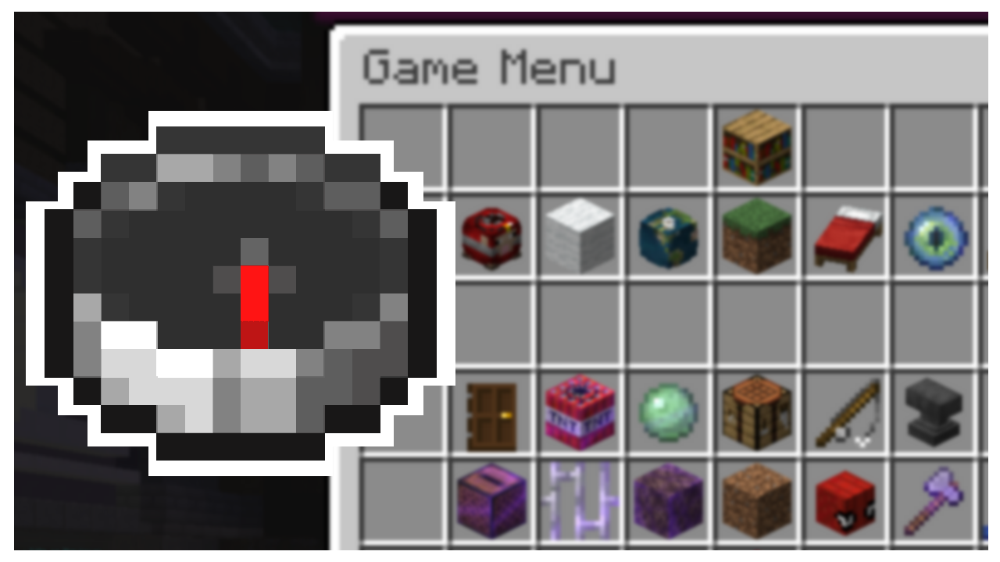

<h1>Minecraft GUI Framework</h1>
<!-- ALL-CONTRIBUTORS-BADGE:START - Do not remove or modify this section -->

<!-- ALL-CONTRIBUTORS-BADGE:END -->

  
  <h2>How it Works 💡</h2>
  <!-- prettier-ignore-start -->
  <!-- markdownlint-disable -->

This repo provides example datapacks for coding GUIs using barrels, minecart chests, and ender chests! There are tons and tons of comments provided to help explain what each line of code does, and you can watch the youtube video to get a better idea of what each module / key component is meant to do. 
The resource pack provides you with assets for building your own GUIs to use with the datapacks.

  <!-- markdownlint-enable -->
  <!-- prettier-ignore-end -->

 
<h2>How to Use 📝</h2>
<!-- prettier-ignore-start -->
<!-- markdownlint-disable -->

To make some UI’s, simply add a folder under <code>ui:menu</code> with the name of your menu. Then add 1 folder per page of the menu, with each folder containing a <strong>“mask”</strong> and <strong>“open”</strong> function. Any item placed in the mask with custom data of <code>ui_item.cmd</code> will run that command, so in the demo the command to go to another page is just the <code>function ui:menu/(path to page)/open</code>. The youtube video covers how to do this quite extensively.

<!-- markdownlint-enable -->
<!-- prettier-ignore-end -->
<h2>Contributors 🧱</h2>
<!-- prettier-ignore-start -->
<!-- markdownlint-disable -->
<table>
  <tr>
    <td align="center"><a href="https://github.com/CloudWolfYT"> <b>Cloud Wolf</b></a> <a href="#" title="Project Creator">🔨</a></td>
    <td align="center"><a href="https://gist.github.com/misode"> <b>Misode</b></a> <a href="#" title="Invisible Minecarts">💡</a></td>
    <td align="center"><a href="https://gist.github.com/IronCrest-sudo"> <b>IronCrest</b></a> <a href="#" title="">💡</a></td>
  </tr>
</table>
<!-- markdownlint-enable -->
<!-- prettier-ignore-end -->